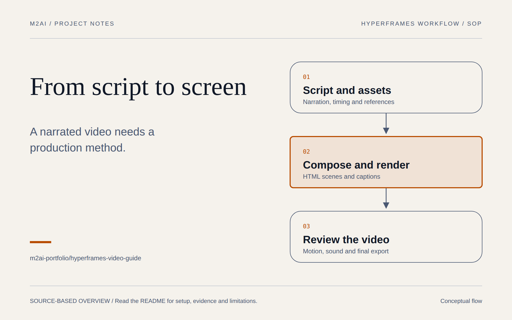

# HyperFrames Video Workflow



A video can pass a render command and still fail its audience: rushed narration, mismatched captions, a blank scene, or music that hides the voice. This guide turns those production lessons into a repeatable workflow, from the first story beat to a reviewed delivery file.

It pairs a readable web guide with a Markdown SOP that a coding agent can follow. The central practice is simple: write the story, generate and measure the narration, build the scenes around it, and inspect the assembled result before rendering.

**[Read the web guide](https://m2ai-portfolio.github.io/hyperframes-video-guide/)** · **[Read the agent SOP](hyperframes-video-workflow.md)**

## What the workflow covers

- A scene-by-scene script with narration, screen text, and capture cues.
- HTML compositions with explicit clip timing and seekable animation.
- Narration-driven timing, music balance, and captions based on the spoken audio.
- Static checks plus snapshots of the assembled composition.
- Human preview, final-file inspection, and a separate publishing step.

The repository is a production guide, not a bundled renderer or a finished video project.

## Open the guide locally

Only Git and a browser are needed to read it:

```bash
git clone https://github.com/m2ai-portfolio/hyperframes-video-guide.git
cd hyperframes-video-guide
```

Open [index.html](index.html) in your browser, or read [hyperframes-video-workflow.md](hyperframes-video-workflow.md) in your editor. There is no build step for this guide.

## Use it on a video project

1. Read the SOP and choose a small story with a clear opening, change, and payoff.
2. Write `SCRIPT.md` with a scene list, narration, on-screen text, and capture requirements.
3. Set up your rendering environment. The guide specifies Node.js 22+, FFmpeg, and HyperFrames; confirm the requirements and commands against the version you install.
4. Choose your narration source. The captured workflow uses ElevenLabs, but you must supply your own permitted voice, credentials, and budget. Existing narration can also be timed with `ffprobe`.
5. Follow the SOP through composition, audio timing, checks, and scene snapshots. Review actual images and listen to the audio.
6. Preview with a human, then render and inspect the delivery file. Treat publication as a separate decision.

On the author's ProBook, use the installed memory-capped `hf-render` wrapper for rendering and run only one render at a time. The generic render commands in the historical SOP do not include that host's resource controls.

## Before adapting the SOP

The voice, provider options, model identifiers, and CLI behavior are recorded production choices, not a promise that current upstream defaults remain identical. Verify them before sending a paid request. Keep credentials in your approved environment or secret store, outside the project and browser code.

The SOP's cloud deployment and publishing commands can create infrastructure or make content public. They are optional stages, not prerequisites for reading or using the local guide. Use music, footage, and voices you have rights to use.

## Maintain the guide

Update the HTML and Markdown together when a production lesson changes. Check the rendered page, review the command sequence against the installed CLI, and distinguish a successful command from a reviewed final video.

Written by Matthew Snow / [M2AI](https://memyselfplusai.com). HyperFrames and the named providers are third-party tools. No license file is included in this snapshot.
